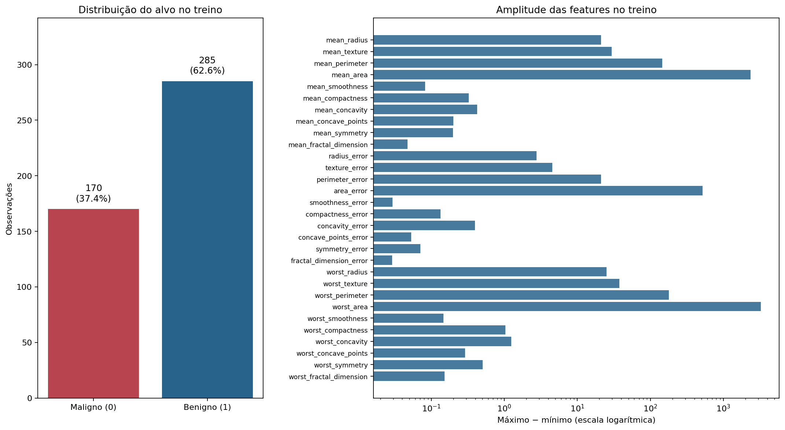
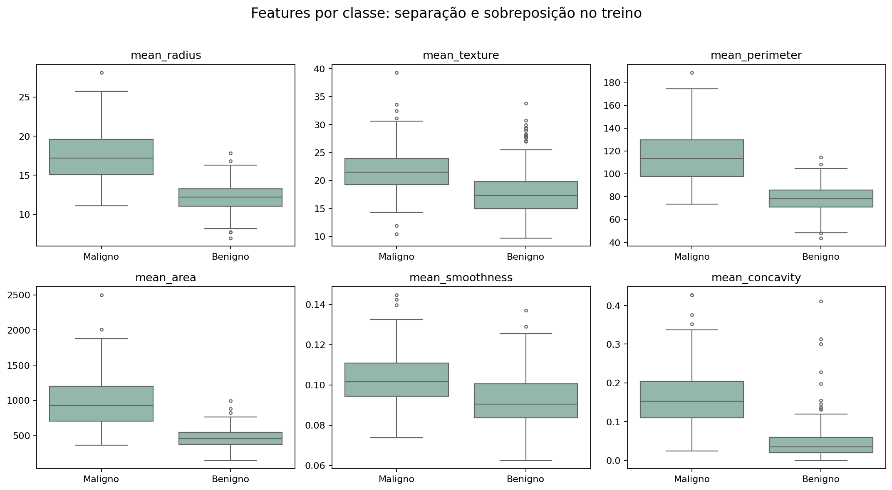
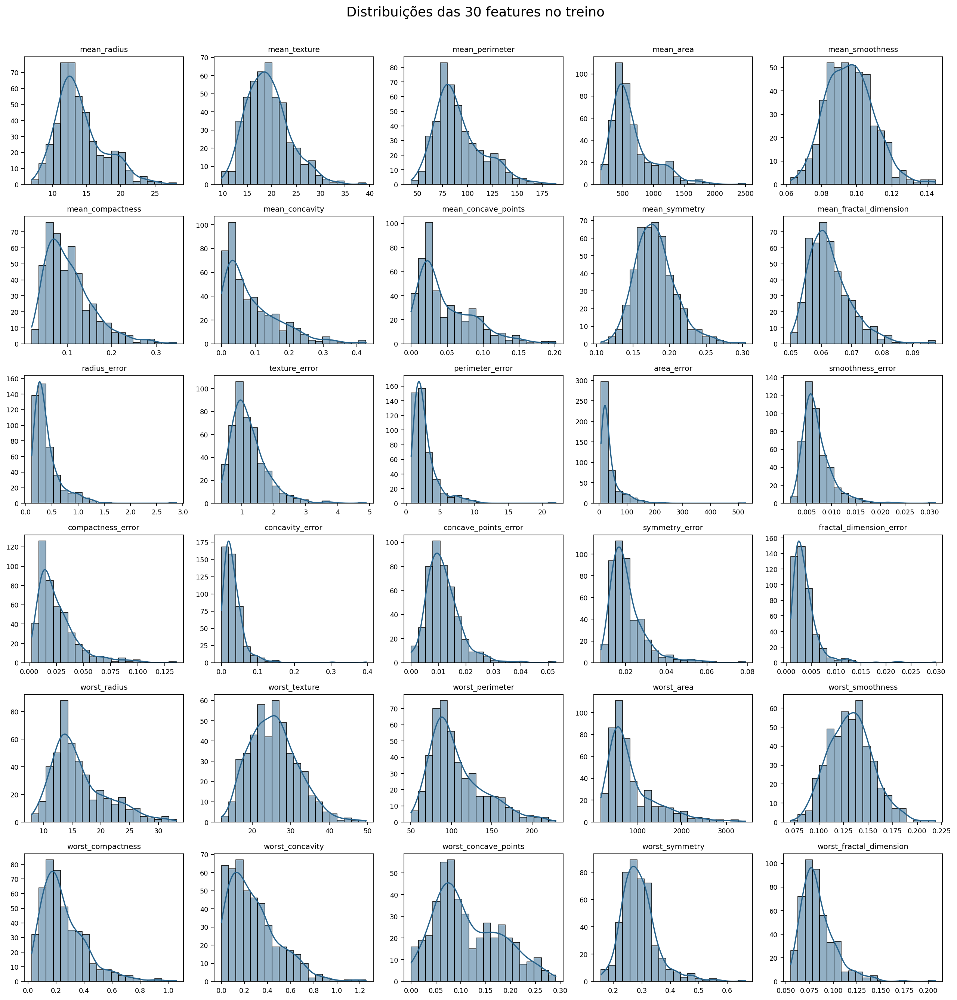
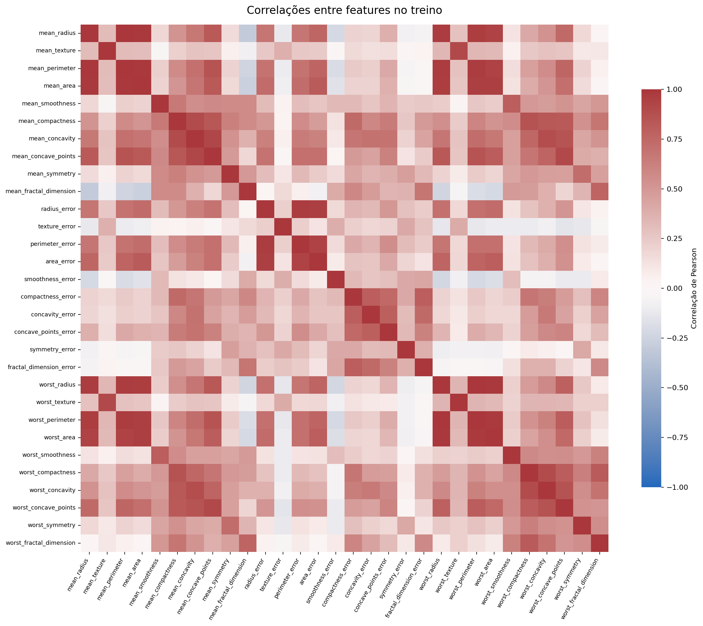
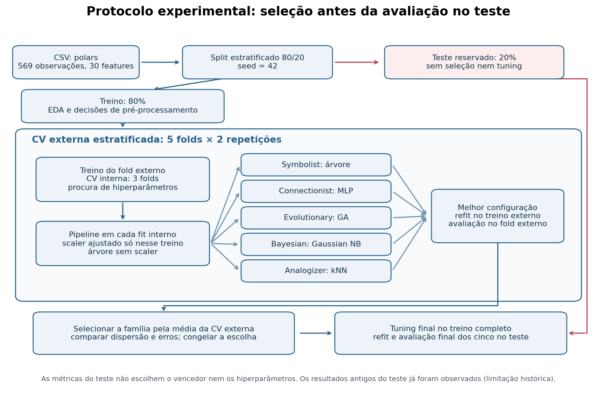
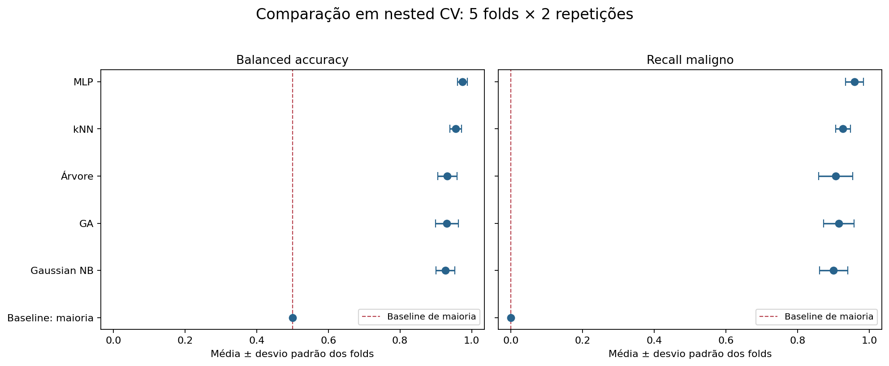
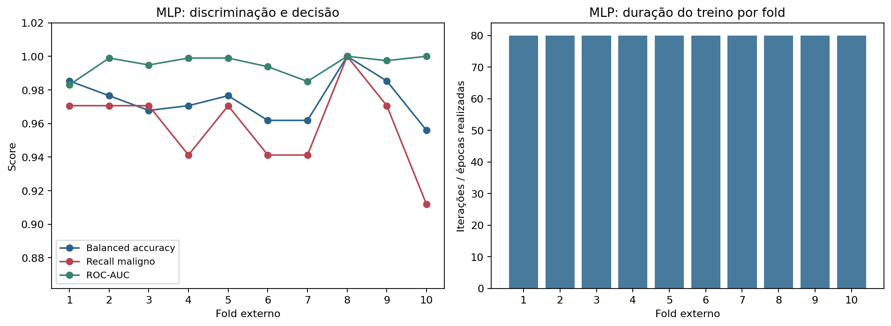
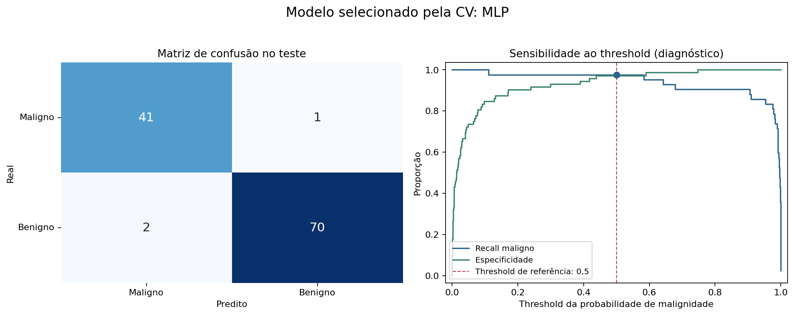
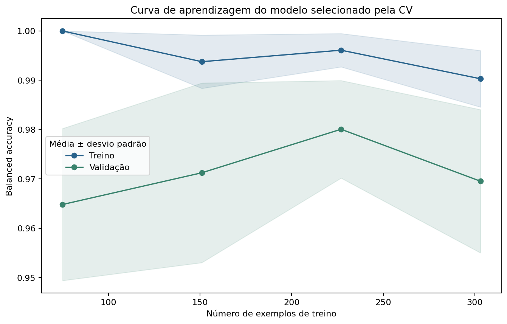

# Project 1 — The Five Classes of Learners

## 1. Identificação

- **Nome:** Eduardo Alves, **N.ºmec** 104179.
- **Data:** 06/11/2026.
- **Unidade curricular:** Fundamentos de Aprendizagem Automática (FAA).
- **Dataset e tarefa:** Breast Cancer Wisconsin Diagnostic; classificação binária de tumores, `0 = maligno` e `1 = benigno`.

Neste projeto, comparei cinco modelos que aprendem de maneiras diferentes. Usei medidas celulares para prever se cada caso era maligno ou benigno. Quis perceber qual dos modelos dava melhores resultados e em que casos falhava. O código está em [project1.py](project1.py).

As medidas usadas para fazer a previsão chamam-se **features**. A resposta correta está na coluna **target**: `0` significa maligno e `1` significa benigno. O modelo recebe as medidas e aprende a prever essa resposta. Neste relatório, uso _modelo_ e _learner_ com o mesmo sentido.

## 2. Modelos

### Escolhas e hipóteses de trabalho

Escolhi um modelo de cada família e organizei a comparação em cinco hipóteses. Servem para organizar a análise.

| Classe         | Modelo e como aprende                                                                            | Porque o escolhi                                                                                                                                                                       | Hipótese comparada na validação cruzada                                   |
| -------------- | ------------------------------------------------------------------------------------------------ | -------------------------------------------------------------------------------------------------------------------------------------------------------------------------------------- | ------------------------------------------------------------------------- |
| Symbolists     | Árvore de decisão: faz uma sequência de perguntas sobre as medidas até chegar a uma previsão.    | Escolhi-a para procurar regras simples, como verificar se o raio ultrapassa um certo valor. Limitei o tamanho da árvore para evitar que decorasse o treino.                            | **H1:** a árvore ultrapassa a baseline de maioria em balanced accuracy.   |
| Connectionists | MLP: uma rede neuronal que combina as medidas e ajusta os pesos das ligações durante o treino.   | Usei uma rede pequena, em Keras/JAX, para aprender relações mais complexas entre as medidas.                                                                                           | **H2:** a MLP ultrapassa a árvore em balanced accuracy.                   |
| Evolutionaries | GA: experimenta conjuntos de pesos e combina os melhores ao longo de várias gerações.            | Usei `pyBlindOpt.GeneticAlgorithm` para aprender os 30 pesos e o valor adicional, chamado bias, de um classificador linear.                                                            | **H3:** a evolução aprende um classificador acima da baseline de maioria. |
| Bayesians      | Gaussian Naive Bayes: compara os valores habituais de cada medida nos casos benignos e malignos. | Escolhi-o para testar um modelo simples de probabilidades. Assume que cada medida pode ser tratada separadamente dentro de cada diagnóstico e segue uma distribuição em forma de sino. | **H4:** a BA supera a baseline apesar da redundância entre features.      |
| Analogizers    | kNN: procura os casos de treino mais parecidos e usa os seus diagnósticos para decidir.          | Usei-o para perceber se casos com medidas semelhantes tendem a ter o mesmo diagnóstico.                                                                                                | **H5:** o kNN tem BA pelo menos igual à MLP e menor desvio entre folds.   |

No GA, cada peso define a contribuição de uma medida para a decisão. O bias é um valor adicional que desloca o limite entre as duas classes. O algoritmo procura combinações que acertem mais e evita pesos demasiado grandes. Para isso, usei o objetivo `1 − balanced_accuracy + l2 × mean(pesos²)`: quanto menor este valor, melhor a solução. Limitei os pesos e o bias ao intervalo `[-3, 3]`.

Calculei esse objetivo com NumPy. Na MLP, usei Keras/JAX para treinar a rede e NumPy para fazer as previsões com os pesos aprendidos. Para cada caso, usei também o score de malignidade do GA, entre 0 e 1: quanto maior, mais o modelo aponta para maligno. Não verifiquei se esses valores correspondem a probabilidades fiáveis.

### Configurações testadas e tempo de execução

Antes de treinar, tive de escolher **hiperparâmetros**. Por exemplo, quantos níveis de perguntas a árvore pode ter ou quantos vizinhos o kNN deve consultar. A tabela mostra as opções que testei.

Para escolher entre essas opções, dividi os dados de treino em três grupos, chamados **folds**. Treinei em dois e avaliei no terceiro, repetindo até cada grupo servir de validação (**validação cruzada (CV)**). Mantive aproximadamente a proporção de benignos e malignos em cada grupo e escolhi a configuração com melhor balanced accuracy, explicada na secção das métricas.

Na tabela, `hidden_units` é o número de unidades da camada interna da rede; `n_pop` é o número de soluções da população do GA; `n_iter` é o número de gerações; e `n_neighbors` é o número de vizinhos. O parâmetro `l2` penaliza pesos grandes. O `var_smoothing` evita problemas numéricos no Gaussian NB quando uma medida varia muito pouco. No kNN, `uniform` dá o mesmo voto a todos os vizinhos e `distance` dá mais peso aos mais próximos.

Treinei a MLP durante 80 épocas sem parar mais cedo.

| Learner         | Espaço de procura                                                                   |
| --------------- | ----------------------------------------------------------------------------------- |
| Árvore          | `{"model__max_depth": [2, 4, null], "model__min_samples_leaf": [1, 4]}`             |
| MLP (Keras/JAX) | `{"model__hidden_units": [16, 32], "model__l2": [0.0001, 0.01]}`                    |
| GA              | `{"model__l2": [0.002, 0.02], "model__n_iter": [18, 36], "model__n_pop": [14, 24]}` |
| Gaussian NB     | `{"model__var_smoothing": [1e-09, 1e-07, 1e-05]}`                                   |
| kNN             | `{"model__n_neighbors": [3, 7, 15], "model__weights": ["uniform", "distance"]}`     |

Depois de comparar as famílias de modelos, voltei a escolher as configurações usando as 455 observações de treino. A tabela seguinte mostra essa procura final. **Candidatos** é o número de configurações; **Fits CV** é o número de treinos para as comparar; e **refit** é o treino da configuração escolhida com todos esses dados. Os tempos desta tabela não incluem a comparação anterior entre famílias.

| Learner         | Configuração selecionada                                       | Candidatos | Fits CV | Procura + refit (s) |
| --------------- | -------------------------------------------------------------- | ---------- | ------- | ------------------- |
| Árvore          | `{"model__max_depth": 4, "model__min_samples_leaf": 1}`        | 6          | 18      | 0,18                |
| MLP (Keras/JAX) | `{"model__hidden_units": 16, "model__l2": 0.01}`               | 4          | 12      | 7,58                |
| GA              | `{"model__l2": 0.02, "model__n_iter": 36, "model__n_pop": 14}` | 8          | 24      | 0,90                |
| Gaussian NB     | `{"model__var_smoothing": 1e-09}`                              | 3          | 9       | 0,05                |
| kNN             | `{"model__n_neighbors": 15, "model__weights": "distance"}`     | 6          | 18      | 0,93                |

No treino final do GA, o algoritmo fez 555 avaliações de soluções. Guardei em [ga_history.csv](results/ga_history.csv) a evolução do valor usado para as comparar, também chamado fitness.

Testei um número limitado de configurações para conseguir executar o trabalho no meu portátil. Assim, os resultados mostram o melhor que encontrei nessas opções. Guardei os resultados de cada configuração em [tuning_candidates.csv](results/tuning_candidates.csv).

## 3. Dataset

### Dados usados e verificações iniciais

Escolhi o **Breast Cancer Wisconsin Diagnostic**, sugerido no enunciado. Guardei num CSV a versão de `sklearn.datasets.load_breast_cancer`, mantendo os diagnósticos e trocando os espaços dos nomes das colunas por underscores. O código de exportação está em [datasets/export_dataset.py](datasets/export_dataset.py).

O dataset tem 569 casos. Cada linha contém 30 medidas numéricas e o diagnóstico correto na coluna `target`. As medidas descrevem dez características dos núcleos celulares, resumidas pela média, pelo erro padrão e por um valor extremo (_worst_). Encontrei 0 valores em falta e 0 linhas repetidas.

| Classe      | Total | Treino | Teste |
| ----------- | ----- | ------ | ----- |
| Maligno (0) | 212   | 170    | 42    |
| Benigno (1) | 357   | 285    | 72    |
| Total       | 569   | 455    | 114   |

O tamanho do dataset permite comparar os cinco métodos rapidamente. Como os modelos já conseguem bons resultados, poucos erros podem mudar a sua ordem na comparação. Para saber se funcionariam bem noutro centro clínico, seria necessário avaliá-los com um dataset desse centro.

Usei **apenas os dados de treino** para fazer os gráficos seguintes e escolher como preparar as medidas. Consultei o ficheiro completo apenas nas verificações de tamanho, valores em falta e duplicados desta execução. Já tinha analisado os dados e os resultados numa primeira versão; explico na metodologia como isso limita a avaliação no teste.



_Figura 1 — Distribuição das classes e amplitudes das features no treino._

Há mais casos benignos do que malignos. Por isso, mantive aproximadamente essa proporção nas divisões dos dados e escolhi uma métrica que dá o mesmo peso às duas classes.

O gráfico mostra também que algumas medidas têm valores muito maiores do que outras. Para evitar que dominassem os cálculos apenas por essa diferença, coloquei as medidas numa escala comparável com StandardScaler. Explico este passo na metodologia. Na árvore, mantive os valores originais.



_Figura 2 — Distribuições de seis features por classe no treino._

Nos gráficos, os casos benignos e malignos tendem a ter valores diferentes de raio, perímetro, área e concavidade. No entanto, há zonas em que se misturam. Isso mostra que uma única medida não chega para acertar em todos os casos. Usei os cinco modelos para combinar a informação das várias medidas.



_Figura 3 — Histogramas das 30 features no treino._

Em algumas medidas, a maioria dos valores está concentrada numa zona e há poucos valores muito elevados. Essa falta de simetria aparece, por exemplo, em `concavity_error`: 5,09; `area_error`: 4,82; `fractal_dimension_error`: 4,09; `perimeter_error`: 3,37. Estes números medem a assimetria da distribuição.

Para procurar valores afastados da maioria, usei a regra de 1,5 × IQR. O IQR é a diferença entre os limites dos 50% centrais dos valores. A regra assinalou 530 medições, contando cada medida de cada caso separadamente. Mantive-as porque um valor extremo pode ser válido. Como não havia valores em falta nem categorias de texto, não precisei de preencher dados ou converter categorias em números. Mantive também a forma original das distribuições, o que pode dificultar o trabalho do Gaussian NB e dos modelos sensíveis a extremos.



_Figura 4 — Correlações de Pearson entre features, com variáveis identificadas._

Uma correlação positiva próxima de 1 indica que duas medidas tendem a aumentar em conjunto. Foi o que observei em `mean_radius`/`mean_perimeter`: r = 0,998; `worst_radius`/`worst_perimeter`: r = 0,993; `mean_radius`/`mean_area`: r = 0,989. Por exemplo, um núcleo com maior raio tende também a ter maior perímetro.

Estas medidas podem repetir informação e dar-lhe mais peso no kNN. O Gaussian NB assume independência entre medidas dentro de cada diagnóstico; este gráfico, que junta as duas classes, não verifica essa condição. Mantive as 30 medidas para todos os modelos. Na MLP e no GA, penalizei pesos grandes para evitar que decorassem os detalhes do treino e falhassem em casos novos (**sobreajustamento**). Esta penalização não elimina a informação repetida.

## 4. Metodologia

### Como treinei e comparei os modelos

Separei os dados em três papéis: **treino**, para o modelo aprender; **validação**, para comparar configurações e modelos; e **teste**, para apresentar a avaliação final. Os grupos de treino e validação vão mudando durante a validação cruzada. O grupo de teste fica fora desse processo.

1. Separei **80% dos casos para treino e 20% para teste**: 455 e 114 casos. Mantive aproximadamente a proporção de benignos e malignos em cada conjunto. Usei a seed `42`, um número fixo que permite repetir a divisão aleatória. Guardei as linhas de cada conjunto em [split_manifest.csv](results/split_manifest.csv).
2. Dividi os 455 casos de treino em **cinco grupos**. Em cada ronda, usei quatro para treinar e um para validar. Fiz duas divisões em cinco grupos, obtendo **dez avaliações** por modelo. Usei os mesmos grupos para todos. No código, esta divisão é feita por `RepeatedStratifiedKFold`.
3. Antes de avaliar em cada grupo de validação, escolhi as configurações usando apenas os outros quatro grupos. Para isso, dividi esse treino em **três grupos internos** e testei as opções com `GridSearchCV`.
4. Treinei a configuração escolhida nos quatro grupos e avaliei-a no grupo que tinha ficado de fora. Guardei as previsões, os resultados e os tempos.
5. Comparei as **médias da balanced accuracy nas dez avaliações**. Escolhi a **MLP (Keras/JAX)** e registei essa escolha antes de calcular os resultados do teste.
6. Voltei a procurar a melhor configuração de cada modelo nos 455 casos de treino, usando três grupos. Depois, treinei com todos esses casos e avaliei os cinco modelos nos 114 casos de teste. Mantive a escolha feita pela validação cruzada.

Este processo tem duas divisões dentro do treino: uma para comparar os modelos e outra, dentro dela, para escolher as configurações. O grupo usado para avaliar numa ronda não participa no treino nem na escolha das configurações dessa ronda.

Já tinha consultado os resultados do teste numa primeira versão do trabalho. Por isso, embora nesta execução tenha escolhido o modelo apenas pela validação cruzada, o teste já não era completamente novo. Os seus resultados descrevem esta experiência; para confirmar o desempenho, precisaria de dados que nunca tivesse usado no desenvolvimento. Nesta execução, não usei o teste para escolher configurações, seeds ou limites de decisão.



_Figura 0 — Pipeline com holdout separado, cinco learners e tuning interno._

O ramo vermelho mostra o caminho dos dados de teste, que ficam fora da escolha de configurações. Usei um **pipeline**, uma sequência que junta a preparação das medidas e o treino do modelo. Assim, repeti os dois passos com os dados de treino de cada ronda, sem usar o grupo de validação para os ajustar.

### O que significam as métricas

- **Balanced accuracy (BA):** calcula a proporção de acertos nos malignos e nos benignos separadamente e depois faz a média. Escolhi-a para dar o mesmo peso às duas classes, apesar de haver mais benignos.
- **Recall maligno:** dos casos que eram realmente malignos, quantos o modelo conseguiu identificar?
- **Precision maligna:** dos casos que o modelo classificou como malignos, quantos eram realmente malignos? Um valor alto significa poucos falsos alarmes entre essas previsões.
- **F1 maligno:** junta precision e recall numa só medida. Para ser alto, o modelo precisa de identificar os malignos e evitar muitos falsos alarmes. Guardei também o **F1 macro**, que faz a média do F1 das duas classes, numa coluna separada.
- **ROC-AUC:** avalia se o modelo dá scores mais altos aos malignos do que aos benignos. Quanto mais próximo de 1, melhor essa separação. Isto não garante que todas as decisões finais estejam certas.
- **Baseline:** é a comparação mais simples. Usei um modelo que responde sempre com a classe mais frequente no treino: benigno. A sua BA é 0,5 e não identifica nenhum maligno.

Nas métricas de malignidade, tratei **maligno (`0`) como a classe positiva**: é a situação que quero detetar. Um **falso negativo (FN)** é um maligno classificado como benigno. Um **falso positivo (FP)** é um benigno classificado como maligno, ou seja, um falso alarme.

Nas tabelas, usei **média ± desvio padrão**. A média resume as dez avaliações; o desvio mostra quanto os resultados variaram. Um desvio menor indica resultados mais parecidos entre divisões. Calculei o desvio padrão amostral com `ddof=1`.

As avaliações reutilizam dados de treino, por isso não são experiências totalmente independentes. Usei o desvio para mostrar a variação, sem o tratar como uma margem de certeza sobre o resultado.

### Como preparei as medidas e fiz as comparações adicionais

Para colocar as medidas em escalas comparáveis, usei **StandardScaler**: subtraí a média de cada medida e dividi pelo seu desvio padrão. Calculei esses valores só no treino e usei-os para transformar também os dados de validação ou teste. Este passo chama-se **scaling** e não significa colocar todos os valores entre 0 e 1.

Apliquei-o à MLP, ao GA, ao Gaussian NB e ao kNN. Na árvore, mantive os valores originais, porque as perguntas da árvore não dependem de comparar a escala de medidas diferentes. No Gaussian NB, o scaling pode alterar o efeito de `var_smoothing`, por isso, comparei também o resultado sem esse passo.

Para perceber o efeito do scaling, comparei a MLP, o kNN e o Gaussian NB com e sem esse passo, mantendo as mesmas configurações e as mesmas três divisões dos dados. Usei MLP com 32 unidades e L2 `1e-4`, kNN com `k=7` e votos iguais, e NB com `var_smoothing=1e-9`.

No GA, quis perceber quanto o resultado depende das escolhas aleatórias. Mantive uma divisão fixa dos dados e as configurações escolhidas dentro do seu treino. Mudei apenas a seed, usando `0, 21, 42, 84, 126`, e apresentei todos os resultados.

Na curva de aprendizagem, comparei o resultado ao treinar com quantidades diferentes de exemplos. Usei três grupos de validação e voltei a escolher as configurações dentro do treino de cada um. Esta análise usa apenas os dados de treino e ajuda a perceber o efeito da quantidade de exemplos.

### Como executar o projeto

Usei Python **3.11**. Para preparar o ambiente e executar o projeto em Windows, a partir da pasta do projeto:

```powershell
python -m venv .venv
.\.venv\Scripts\python.exe -m pip --isolated install --no-user -r requirements.txt
.\.venv\Scripts\python.exe project1.py
```

Com GNU Make instalado, a sequência equivalente é:

```text
make venv
make check
make run
```

## 5. Avaliação e conclusão

### Comparação na validação cruzada

Reuni na tabela os resultados das dez avaliações. Em cada célula, o primeiro valor é a média e o valor depois de `±` mostra quanto os resultados variaram. Por exemplo, BA `0,974 ± 0,013` significa uma BA média de 97,4%, com desvio padrão de 1,3 pontos percentuais. Não significa que o modelo acertou exatamente 97,4% de todos os casos: a BA dá o mesmo peso ao acerto em cada classe.

Quanto maior o valor das métricas, melhor. Apresentei o F1 da **classe maligna**; o F1 macro está numa coluna separada dos CSV.

| Learner             | BA            | Recall maligno | Precision maligna | F1 maligno    | ROC-AUC       |
| ------------------- | ------------- | -------------- | ----------------- | ------------- | ------------- |
| Árvore              | 0,932 ± 0,027 | 0,906 ± 0,048  | 0,929 ± 0,038     | 0,916 ± 0,032 | 0,932 ± 0,035 |
| MLP (Keras/JAX)     | 0,974 ± 0,013 | 0,959 ± 0,025  | 0,982 ± 0,020     | 0,970 ± 0,016 | 0,995 ± 0,006 |
| GA                  | 0,931 ± 0,032 | 0,915 ± 0,043  | 0,913 ± 0,047     | 0,913 ± 0,040 | 0,979 ± 0,018 |
| Gaussian NB         | 0,926 ± 0,026 | 0,900 ± 0,040  | 0,920 ± 0,040     | 0,909 ± 0,033 | 0,988 ± 0,007 |
| kNN                 | 0,955 ± 0,016 | 0,926 ± 0,021  | 0,973 ± 0,035     | 0,949 ± 0,022 | 0,985 ± 0,012 |
| Baseline de maioria | 0,500 ± 0,000 | 0,000 ± 0,000  | 0,000 ± 0,000     | 0,000 ± 0,000 | 0,500 ± 0,000 |

Escolhi a **MLP (Keras/JAX)** porque teve a maior BA média, **0,974 ± 0,013**. Este era o critério que defini no código antes de avaliar o teste. Foi o melhor modelo entre as opções que experimentei; com outros dados ou configurações, o resultado poderia mudar.



_Figura 5 — Balanced accuracy e recall maligno, com dispersão nos folds externos._

A baseline acerta muitos casos porque há mais benignos, mas falha todos os malignos. O gráfico ajuda a ver essa diferença. As barras mostram quanto os resultados variaram entre divisões dos dados; só o facto de se sobreporem ou não se sobreporem não prova que um modelo seja melhor.

Comparei também cada modelo com a MLP nas mesmas dez avaliações, calculando `BA(modelo) − BA(MLP)`. Um valor negativo significa que ficou abaixo da MLP; um valor positivo significa que ficou acima. Em **V/E/D**, contei quantas vezes venceu, empatou ou perdeu. Por exemplo, `1/0/9` significa uma vitória, nenhum empate e nove derrotas.

| Modelo              | Referência      | Diferença média ± desvio | V/E/D  | Folds |
| ------------------- | --------------- | ------------------------ | ------ | ----- |
| Árvore              | MLP (Keras/JAX) | -0,042 ± 0,028           | 1/0/9  | 10    |
| GA                  | MLP (Keras/JAX) | -0,043 ± 0,028           | 0/1/9  | 10    |
| Gaussian NB         | MLP (Keras/JAX) | -0,048 ± 0,027           | 0/0/10 | 10    |
| kNN                 | MLP (Keras/JAX) | -0,019 ± 0,019           | 2/0/8  | 10    |
| Baseline de maioria | MLP (Keras/JAX) | -0,474 ± 0,013           | 0/0/10 | 10    |

### Diagnóstico da MLP

Na MLP, obtive BA **0,974 ± 0,013**, recall maligno **0,959 ± 0,025** e ROC-AUC **0,995 ± 0,006**.



_Figura 8 — Métricas e número de épocas da MLP em cada fold externo._

Usei esta figura para ver quanto os resultados da MLP variaram entre avaliações. Treinei sempre durante 80 épocas. O gráfico mostra essa variação, mas não explica a causa de cada diferença.

Para decidir a classe, o modelo usa um **threshold**, ou limite de decisão. Um score de malignidade acima de 0,5 leva à previsão de maligno; abaixo desse valor, à previsão de benigno.

No fold 10, obtive recall maligno de 0,912 e AUC de 1,000. O modelo deu scores mais altos aos malignos do que aos benignos, mas alguns malignos ficaram abaixo de 0,5. Por isso, uma AUC perfeita não significou acertar todas as classes. Mantive o limite usado pelo modelo.

### Efeito da escala e das escolhas aleatórias

| Configuração fixa | StandardScaler | BA na CV de treino |
| ----------------- | -------------- | ------------------ |
| MLP (Keras/JAX)   | Não            | 0,500 ± 0,000      |
| MLP (Keras/JAX)   | Sim            | 0,974 ± 0,023      |
| Gaussian NB       | Não            | 0,932 ± 0,012      |
| Gaussian NB       | Sim            | 0,925 ± 0,017      |
| kNN               | Não            | 0,922 ± 0,008      |
| kNN               | Sim            | 0,950 ± 0,018      |

Aqui comparei os modelos com e sem StandardScaler, mantendo as configurações indicadas na metodologia. Usei três divisões dos dados. Esta é uma comparação adicional, separada das dez avaliações da tabela principal.

Com scaling, a BA média da MLP passou de 0,500 para 0,974 (diferença 0,474), e a do kNN de 0,922 para 0,950 (diferença 0,028). No Gaussian NB, desceu de 0,932 para 0,925 (diferença -0,007). Assim, colocar as medidas em escalas comparáveis ajudou a MLP e o kNN nestes dados, mas não melhorou o Gaussian NB. Usei esta análise para perceber o efeito desse passo, mantendo a comparação principal.

| Seed do GA | BA na validação fixa | Recall maligno |
| ---------- | -------------------- | -------------- |
| 0          | 0,927                | 0,941          |
| 21         | 0,912                | 0,912          |
| 42         | 0,977                | 0,971          |
| 84         | 0,953                | 0,941          |
| 126        | 0,941                | 0,971          |

Nesta tabela, mantive os mesmos dados e configurações e mudei apenas a seed, que controla as escolhas aleatórias do GA. Obtive BA entre 0,912 e 0,977. Isto mostra que o resultado também depende do caminho seguido pelo algoritmo durante a procura.

### Avaliação no conjunto de teste

Depois de escolher a MLP pela validação cruzada, avaliei os cinco modelos nos 114 casos de teste. Como já tinha consultado este conjunto numa versão anterior, estes resultados têm a limitação explicada na metodologia. Nas colunas FN e FP, mostro diretamente quantos malignos passaram por benignos e quantos benignos geraram falsos alarmes.

| Learner             | BA    | Recall maligno | Precision maligna | F1 maligno | ROC-AUC | FN  | FP  |
| ------------------- | ----- | -------------- | ----------------- | ---------- | ------- | --- | --- |
| Árvore              | 0,930 | 0,929          | 0,886             | 0,907      | 0,917   | 3   | 5   |
| MLP (Keras/JAX)     | 0,974 | 0,976          | 0,953             | 0,965      | 0,995   | 1   | 2   |
| GA                  | 0,938 | 0,905          | 0,950             | 0,927      | 0,986   | 4   | 2   |
| Gaussian NB         | 0,925 | 0,905          | 0,905             | 0,905      | 0,987   | 4   | 4   |
| kNN                 | 0,964 | 0,929          | 1,000             | 0,963      | 0,993   | 3   | 0   |
| Baseline de maioria | 0,500 | 0,000          | 0,000             | 0,000      | 0,500   | 42  | 0   |

Com a **MLP (Keras/JAX)**, obtive BA **0,974** no teste. Dos 42 casos malignos, identificou 41 e deixou passar **1** (FN). Dos 72 benignos, classificou **2** como malignos (FP). A escolha da MLP já tinha sido feita pela validação cruzada.



_Figura 6 — Matriz de confusão e diagnóstico de threshold do modelo selecionado pela CV._

A matriz mostra os acertos e os dois tipos de erro. Na curva, comparei o que acontece quando mudo o limite para considerar um caso maligno. Um limite mais baixo tende a encontrar mais malignos, mas também pode criar mais falsos alarmes. A **especificidade** mostra a proporção de benignos corretamente identificados.

Assinalei o limite de 0,5 como referência. Usei o gráfico apenas para perceber esse equilíbrio, para escolher outro limite, teria de usar os dados de validação antes de consultar o teste.

Usei `row_id`, o índice de cada caso no dataset a contar de zero, para localizar os casos em que a MLP falhou. Na tabela, mostro o diagnóstico real, a previsão e algumas medidas nos seus valores originais, sem scaling.

| row_id | Real | Predito | p(maligno) | mean_radius | mean_texture | mean_concavity |
| ------ | ---- | ------- | ---------- | ----------- | ------------ | -------------- |
| 363    | 1    | 0       | 0,590      | 16,50       | 18,29        | 0,059          |
| 541    | 1    | 0       | 0,746      | 14,47       | 24,99        | 0,101          |
| 73     | 0    | 1       | 0,112      | 13,80       | 15,79        | 0,078          |

Mantive estes casos na avaliação e não alterei o modelo por causa deles. A tabela mostra onde falhou, mas não explica a causa clínica de cada erro. Há poucos casos para concluir se o modelo falha mais num determinado grupo de pessoas.

O maligno não detetado, `row_id=73`, recebeu `p(maligno)=0,112`, longe de 0,5. Portanto, nem todos os erros ficaram perto do limite de decisão. Apesar do nome `p(maligno)`, não confirmei se estes valores correspondem à frequência real de malignidade. Usei-os como saídas do modelo, sem os tratar como certezas sobre o diagnóstico.

### Custos dos erros

Os dois erros podem ter importâncias diferentes. Comparei cenários com o mesmo peso para ambos e com mais peso para os malignos não detetados (FN) do que para os falsos alarmes (FP). Na razão **5:1**, por exemplo, cada FN conta tanto como cinco FP. Calculei `custo = razão_FN × FN + FP`.

Escolhi pesos **hipotéticos**: não representam custos clínicos reais. A coluna «Custo por 100 observações» põe os valores na mesma base de comparação. É uma pontuação ponderada, não uma contagem de pessoas, e por isso pode ultrapassar 100.

| Modelo              | Custo FN : FP | Custo no teste | Custo por 100 observações |
| ------------------- | ------------- | -------------- | ------------------------- |
| Árvore              | 1 : 1         | 8              | 7,02                      |
| Árvore              | 5 : 1         | 20             | 17,54                     |
| Árvore              | 10 : 1        | 35             | 30,70                     |
| MLP (Keras/JAX)     | 1 : 1         | 3              | 2,63                      |
| MLP (Keras/JAX)     | 5 : 1         | 7              | 6,14                      |
| MLP (Keras/JAX)     | 10 : 1        | 12             | 10,53                     |
| GA                  | 1 : 1         | 6              | 5,26                      |
| GA                  | 5 : 1         | 22             | 19,30                     |
| GA                  | 10 : 1        | 42             | 36,84                     |
| Gaussian NB         | 1 : 1         | 8              | 7,02                      |
| Gaussian NB         | 5 : 1         | 24             | 21,05                     |
| Gaussian NB         | 10 : 1        | 44             | 38,60                     |
| kNN                 | 1 : 1         | 3              | 2,63                      |
| kNN                 | 5 : 1         | 15             | 13,16                     |
| kNN                 | 10 : 1        | 30             | 26,32                     |
| Baseline de maioria | 1 : 1         | 42             | 36,84                     |
| Baseline de maioria | 5 : 1         | 210            | 184,21                    |
| Baseline de maioria | 10 : 1        | 420            | 368,42                    |

Quando os dois erros têm o mesmo peso (1:1), a MLP e o kNN empatam com custo 3. Ao dar mais peso aos malignos não detetados, a MLP tem o menor custo: 7 na razão 5:1 e 12 na razão 10:1.

Na razão 5:1, a MLP tem custo 7, contra 15 do kNN. O kNN foi o segundo melhor na validação cruzada, mas deixou passar mais malignos no teste. Por isso, fica mais penalizado quando aumento o peso desse erro.

Calculei estes valores a partir dos erros já obtidos, sem voltar a treinar. Mantive a escolha do modelo pela BA na validação cruzada. Se tivesse custos reais definidos, poderia estudar outro limite de decisão nos dados de treino e validação.



_Figura 7 — Curva de aprendizagem com tuning repetido dentro de cada treino/subamostra._

Nesta curva, aumentei a quantidade de exemplos usados para treinar. Comparei o resultado nos dados usados para aprender com o resultado nos dados que tinham ficado de fora para validação. Se o modelo for muito melhor no treino, pode estar a aprender detalhes que não se repetem em casos novos. As faixas mostram quanto os resultados variaram entre divisões.

Obtive BA de validação de 0,965 com 75 exemplos de treino e de 0,970 com 303. Com 303 exemplos, a diferença entre treino e validação foi de 0,021. Estes resultados mostram o que aconteceu nas amostras testadas, sem garantir a mesma melhoria com novos dados.

Acrescentar exemplos nem sempre melhorou o resultado de validação. As divisões dos dados, as configurações escolhidas e o próprio treino podem explicar essas oscilações. No modelo final, usei todos os dados de treino. Como esta curva usa o mesmo conjunto em que escolhi a MLP, não é uma confirmação com dados novos.

### Resposta às hipóteses e conclusão

| Hipótese de trabalho                           | Leitura descritiva | Evidência na CV                                                    |
| ---------------------------------------------- | ------------------ | ------------------------------------------------------------------ |
| H1 — árvore acima da baseline                  | Compatível         | BA 0,932, versus 0,500 da baseline.                                |
| H2 — MLP supera a árvore                       | Compatível         | BA MLP 0,974; árvore 0,932.                                        |
| H3 — GA aprende acima da baseline              | Compatível         | BA GA 0,931; a evolução aprende os 31 parâmetros do classificador. |
| H4 — NB supera a baseline apesar da correlação | Compatível         | BA NB 0,926; AUC 0,988.                                            |
| H5 — kNN ≥ MLP em BA e é menos variável        | Não apoiada        | BA kNN 0,955, MLP 0,974; desvios 0,016 e 0,013.                    |

Escolhi a **MLP (Keras/JAX)** porque teve a maior balanced accuracy média na validação cruzada. Todos os modelos ficaram acima da comparação mais simples, que responde sempre benigno. A comparação mostrou também que encontrar mais malignos, criar menos falsos alarmes e treinar mais depressa são vantagens diferentes. As conclusões aplicam-se aos modelos e configurações que testei.

O dataset usado é pequeno, poucas configurações e várias medidas com informação semelhante. As avaliações reutilizam parte dos dados. Escrevi as hipóteses depois dos primeiros resultados e já tinha consultado o teste durante o desenvolvimento.

Como próximos passos, avaliaria os modelos com novos dados. Definiria a importância de cada erro e quantos malignos queria conseguir detetar antes de escolher outro limite de decisão. Verificaria também se os scores representam bem as probabilidades e se remover medidas muito semelhantes ou reduzir o efeito de valores extremos melhora os resultados. Faria essas escolhas apenas com os dados de treino e validação.

### Ficheiros de resultados

| Artefacto                                                                | Conteúdo                                                                                      |
| ------------------------------------------------------------------------ | --------------------------------------------------------------------------------------------- |
| [cross_validation.csv](results/cross_validation.csv)                     | Médias e desvios das métricas na nested CV, incluindo baseline.                               |
| [selection.json](results/selection.json)                                 | Família e critério de seleção registados antes da avaliação no teste.                         |
| [fold_scores.csv](results/fold_scores.csv)                               | Métricas, tempos e configurações de cada fold externo.                                        |
| [tuning.csv](results/tuning.csv)                                         | Melhor configuração, custo e dimensão da procura final por learner.                           |
| [tuning_candidates.csv](results/tuning_candidates.csv)                   | Resultados de todos os candidatos nas procuras internas e na procura final.                   |
| [final_test.csv](results/final_test.csv)                                 | Avaliação final descritiva e contagens de erros dos cinco learners.                           |
| [best_classification_report.txt](results/best_classification_report.txt) | Precision, recall e F1 por classe do modelo selecionado.                                      |
| [paired_comparisons.csv](results/paired_comparisons.csv)                 | Diferenças de BA nos mesmos folds e V/E/D.                                                    |
| [cost_scenarios.csv](results/cost_scenarios.csv)                         | Cenários explícitos de custos hipotéticos de FN/FP.                                           |
| [holdout_errors.csv](results/holdout_errors.csv)                         | Casos do teste incorretamente previstos pelo modelo selecionado.                              |
| [learning_curve.csv](results/learning_curve.csv)                         | Tamanhos e métricas da curva de aprendizagem.                                                 |
| [mlp_diagnostics.csv](results/mlp_diagnostics.csv)                       | Métricas e épocas da MLP nos folds externos.                                                  |
| [split_manifest.csv](results/split_manifest.csv)                         | Identificação das observações de treino/teste.                                                |
| [outer_fold_manifest.csv](results/outer_fold_manifest.csv)               | Identificação das partições externas de CV.                                                   |
| [outer_predictions.csv](results/outer_predictions.csv)                   | Predições externas por observação, repetição e modelo.                                        |
| [ga_history.csv](results/ga_history.csv)                                 | Evolução da fitness no refit final do GA.                                                     |
| [ga_seed_sensitivity.csv](results/ga_seed_sensitivity.csv)               | Resultados de todas as seeds do controlo do GA.                                               |
| [scaling_ablation.csv](results/scaling_ablation.csv)                     | Controlo com/sem scaler nas configurações fixas.                                              |
| [run_summary.json](results/run_summary.json)                             | Resumo dos dados, configurações e resultados da execução.                                     |
| [environment.json](results/environment.json)                             | Python, dependências, backend, hardware e execução.                                           |
| [validation.json](results/validation.json)                               | Verificação da execução integral do script Python, das dependências e dos artefactos gerados. |

Organizei o código em `project1.py`, com os modelos e a avaliação, e `project1_plots.py`, com as funções dos gráficos. Ao executar `project1.py`, são geradas as figuras e os resultados da experiência.
